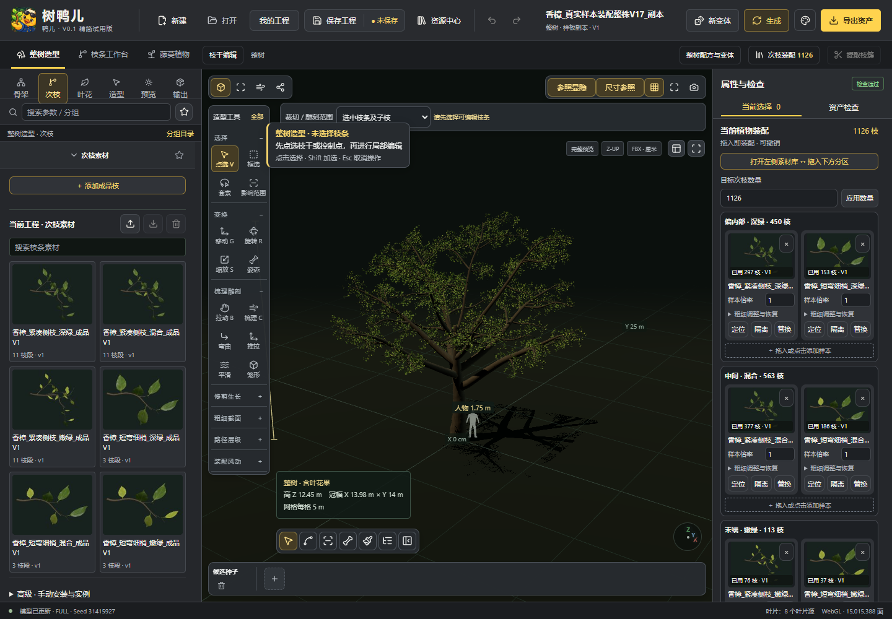
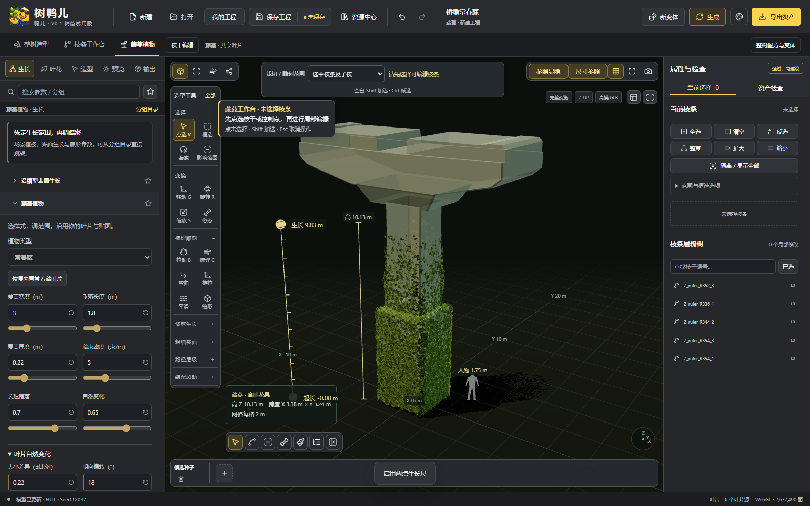

  

<strong>从一根枝条，到一整片绿意。</strong> 面向游戏场景、植物制作与环境美术的创作工具。

  <a href="docs/quick-start.md"><strong>快速开始 ↗</strong></a>　·　
  <a href="docs/README.md">使用文档</a>　·　
  <a href="docs/feedback.md">反馈建议</a>　·　
  <a href="docs/source-status.md">源码与版本</a>

> **文档与反馈已开放 · 软件源码与发行包筹备中。** [查看准备进度 →](docs/source-status.md)

## 看见植物，也掌握细节

从整株轮廓开始，再进入枝条与藤蔓工作区。围绕实际制作任务调整植物，让作品保留继续编辑的空间。

  

V0.1 精简试用版实际软件画面 · 界面与功能以对应版本随包说明为准

| 01 · 整树造型 | 02 · 枝条编辑 | 03 · 藤蔓制作 |
| :--- | :--- | :--- |
| 从整株样板出发，建立轮廓，调整结构与枝叶组合。 | 进入局部结构，细化植物形态，处理枝条与样本组合。 | 组织植物的覆盖与垂挂，丰富建筑和道具的层次。 |

<strong>再看一个工作区：藤蔓植物 ↘</strong>

先建立整体覆盖，再按创作需要调整局部。上图为 V0.1 精简试用版实际画面。

## 选一个入口，开始了解

<table width="100%">
  <tr>
    <td width="33%" align="center" valign="top">
      
      <h3><a href="docs/README.md">使用文档 ↗</a></h3>
      
从第一株植物开始， 到工程、素材与导出。

      
<a href="docs/quick-start.md">快速开始</a> · <a href="docs/faq.md">常见问题</a>

    </td>
    <td width="34%" align="center" valign="top">
      
      <h3><a href="docs/feedback.md">一起改进 ↗</a></h3>
      
遇到问题，或有想法？ 从具体制作任务说起。

      
<a href="https://github.com/NongNongYaEr/ShuYaEr/issues/new/choose">选择反馈类型</a>

    </td>
    <td width="33%" align="center" valign="top">
      
      <h3><a href="docs/source-status.md">源码与版本 ↗</a></h3>
      
了解公开范围， 查看当前准备进度。

      
<a href="https://github.com/NongNongYaEr/ShuYaEr/releases">发行记录</a>

    </td>
  </tr>
</table>

## 下载与资源，分清这三件事

| 桌面版 | 软件源码 | 配套资产 |
| :--- | :--- | :--- |
| 用于直接开始制作。正式下载入口确认后公布；本仓库目前没有提供安装包。 | 用于研究与自行构建。源码、依赖和构建说明仍在整理，当前文档与图片不是完整软件源码。 | 植物样板、枝条与藤蔓素材，在网站资产库单独维护，按内容说明获取。 |

桌面版、源码标签与资产分别标注版本；实际可获取文件以对应项目说明和[发行记录](https://github.com/NongNongYaEr/ShuYaEr/releases)为准。正式官网地址准备好后会补充到这里。

<strong>参与反馈与授权说明</strong>

欢迎提出制作需求、软件问题和文档建议。[反馈中心](docs/feedback.md)提供故障反馈与功能建议两条路径。账号、订单、付款与会员问题，通过软件所属网站的站内反馈处理；GitHub Issues 会公开展示。

源码开放范围与许可证尚待确认，本仓库暂未附加开源许可证。配套资产的获取范围和授权说明独立维护。

---

由 <a href="https://github.com/NongNongYaEr"><strong>弄弄鸭儿大公司</strong></a> 打磨 鸭鸭创作软件，让你好用到飞起来

