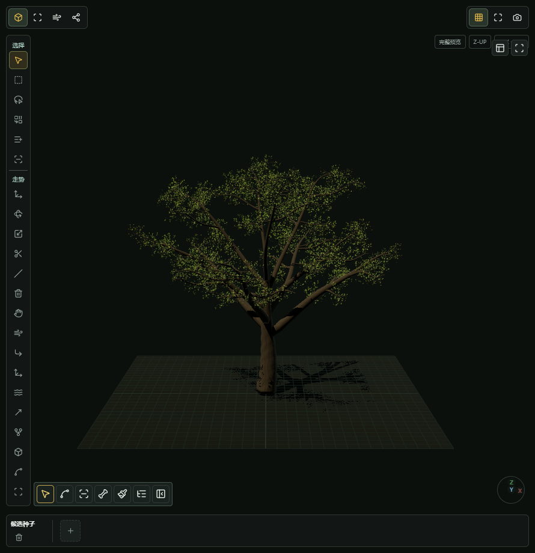
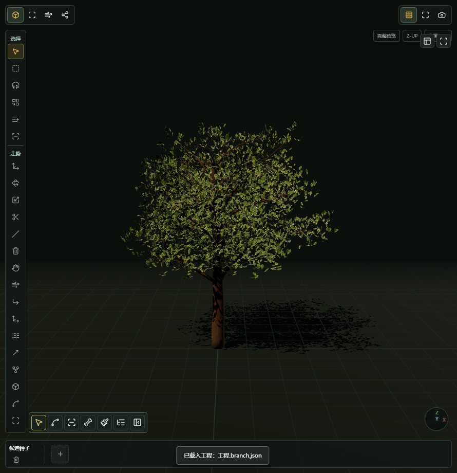
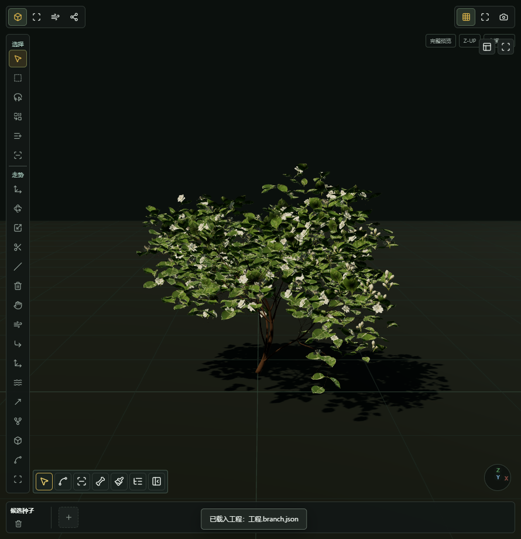
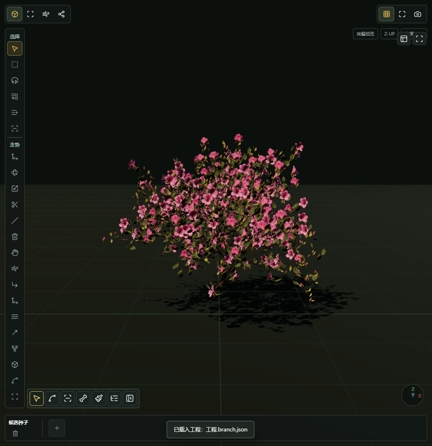

[项目首页](../README.md) / [使用文档](README.md) / 植物作品展示

<table width="100%">
  <tr>
    <td width="88" align="center"></td>
    <td><h1>从一株植物，看见更多可能</h1>
树形、枝叶与花朵，各有自己的轮廓。
</td>
  </tr>
</table>

这里展示现有植物样板在树鸭儿视口中的实际画面。保留原始截图，方便观察造型与枝叶层次；图片不是引擎成片，也不代表已经提供对应下载包。

## 四种植物，四种形态

<table width="100%">
  <tr>
    <td width="50%" valign="top">
      
      <h3>01 · 香樟</h3>
      
<strong>观察整体骨架。</strong>从主干分叉到外层树冠，先看轮廓，再看枝条如何组织起来。

    </td>
    <td width="50%" valign="top">
      
      <h3>02 · 海桐</h3>
      
<strong>观察枝叶密度。</strong>集中、丰满的形态，适合比较树冠内部与边缘的层次变化。

    </td>
  </tr>
  <tr>
    <td width="50%" valign="top">
      
      <h3>03 · 茉莉</h3>
      
<strong>观察叶片与花朵。</strong>小型植物也有自己的疏密节奏，留意枝叶之间的空隙。

    </td>
    <td width="50%" valign="top">
      
      <h3>04 · 杜鹃</h3>
      
<strong>观察开花层次。</strong>花朵与绿叶共同构成轮廓，重点比较颜色分布与外缘形态。

    </td>
  </tr>
</table>

## 让植物进入场景结构

上图是 V0.1 精简试用版的藤蔓工作区，展示常春藤与桥墩模型的关系。先看覆盖范围和垂挂轮廓，再按制作需要处理局部。它是软件工作区截图，界面与功能以对应版本说明为准。

## 从展示走到制作

| 想了解的内容 | 下一步 |
| :--- | :--- |
| 从样板开始自己的植物 | [按五个步骤快速开始](quick-start.md) |
| 分清工程、素材与导出文件 | [工程与资产](faq.md#工程与资产) |
| 了解样板与软件的准备状态 | [源码与版本进度](source-status.md) |
| 分享新的植物制作需求 | [提出功能建议](feedback.md) |

正式素材入口与兼容说明准备好后，会在对应资源页提供；展示图片不替代素材包的获取和授权说明。

---

[开始制作 →](quick-start.md)　·　[文档目录](README.md)　·　[项目首页](../README.md)
